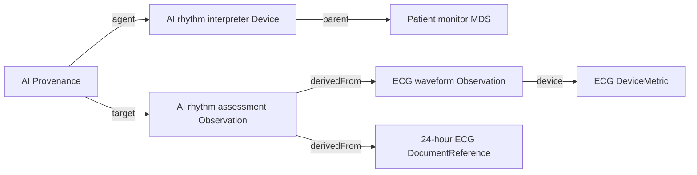

The PoCD Implementation Guide can be used in conjunction with the [AI Transparency IG](http://hl7.org/fhir/uv/aitransparency). This example shows an AI function within a point-of-care device system that analyzes a 24-hour ambulatory ECG recording and detects intermittent atrial fibrillation episodes not apparent from a point-in-time sinus-rhythm status. The assessment is coded, includes an illustrative model-confidence score, and identifies the model version through the AI Device.

### AI device and workflow

The [AI rhythm interpretation device](Device-AIRhythmInterpretationDevice.html) conforms to the AI Transparency IG's [AI Device profile](https://hl7.org/fhir/uv/aitransparency/2026Jan/StructureDefinition-AI-Device.html). Its `Device.parent` references the patient monitor MDS, representing the AI function as part of that device system. The AI Device identifies the interpreting component; it does not replace the DeviceMetric that identifies the source of a measurement.

The [24-hour ambulatory ECG recording](DocumentReference-AmbulatoryECGRecording.html) represents the full input interval; its attachment URL is a placeholder. The [ECG waveform Observation](Observation-ECGSampleArrayObservation.html) is only a one-second excerpt, not the full input used to support a sustained rhythm assessment. The point-in-time [rhythm Observation](Observation-RhythmStatusEnumerationObservation.html) reports sinus rhythm at the end of the recording, while the AI assessment identifies episodes earlier in the interval.

### Observation examples

The example represents the AI finding as a distinct Observation:

- The [AI rhythm assessment Observation](Observation-AIRhythmAssessment.html) is derived from the full recording and its one-second waveform excerpt. It carries the `AIAST` security label, codes atrial fibrillation using SNOMED CT, and reports the number and longest duration of detected episodes. These result values are illustrative, not clinical reference data; the model-confidence value is not a calibrated probability or clinical risk estimate.

The device-reported sinus rhythm remains unchanged as a point-in-time source result; it is not copied into an AI output. The example illustrates longitudinal analysis producing a finding distinct from that status, rather than a deterministic code-to-code mapping. The referenced recording and model output are illustrative; this is not clinical reference data.

### AI attribution and provenance

The AI Transparency IG defines the [AI Provenance profile](https://hl7.org/fhir/uv/aitransparency/2026Jan/StructureDefinition-AI-Provenance.html). The [Provenance example](Provenance-AIRhythmInterpretation.html) conforms to that profile and records the AI Device as the author agent, the activity as longitudinal ECG analysis, and the AI-derived assessment as its target. The output's `derivedFrom` references retain links to the full recording and the illustrative waveform excerpt.

The AI-derived Observation uses the `AIAST` security label, the artificial-intelligence-asserted code from the [HL7 v3 ObservationValue code system](http://terminology.hl7.org/CodeSystem/v3-ObservationValue). Use the AI Transparency IG's AI Provenance profile to associate the AI agent and activity with the output. The example identifies the model and version but does not include a model card or prompt; these may be provided as additional transparency context where appropriate.