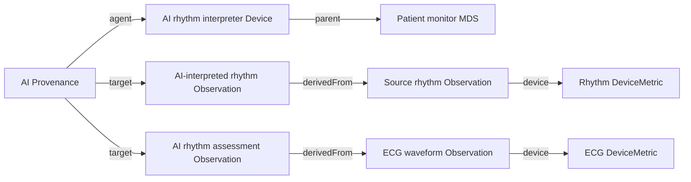

The PoCD Implementation Guide can be used in conjunction with the [AI Transparency IG](http://hl7.org/fhir/uv/aitransparency). This page illustrates that approach through an example showing how an AI function can be represented within a point-of-care device system, with its AI-generated Observations and Provenance.

### AI device and workflow

The [AI rhythm interpretation device](Device-AIRhythmInterpretationDevice.html) conforms to the AI Transparency IG's [AI Device profile](https://hl7.org/fhir/uv/aitransparency/2026Jan/StructureDefinition-AI-Device.html). Its `Device.parent` references the patient monitor MDS, representing the AI function as part of that device system. The AI Device identifies the interpreting component; it does not replace the DeviceMetric that identifies the source of a measurement.

The source ECG waveform and rhythm observations each reference their corresponding DeviceMetric. AI outputs link back to the source Observation using `Observation.derivedFrom`. The Provenance resource identifies the AI Device as the agent and targets both AI-influenced Observations.

### Observation examples

The examples illustrate two ways to represent AI output:

- [AI-interpreted rhythm Observation](Observation-AIInterpretedRhythmObservation.html) is a separate AI-influenced Observation derived from the [source rhythm Observation](Observation-RhythmStatusEnumerationObservation.html). It carries the `AIAST` security label and retains a `device` reference to the rhythm DeviceMetric, preserving the measurement context. Its `interpretation` element gives the interpretation value; the source Observation itself is not overwritten.
- [AI rhythm assessment Observation](Observation-AIRhythmAssessment.html) is a distinct assessment derived from the [ECG waveform Observation](Observation-ECGSampleArrayObservation.html). It carries the `AIAST` security label and links to the waveform through `derivedFrom`.

When recording an AI interpretation as a separate Observation, link it to its source with `derivedFrom`. When an AI-generated assertion is recorded in an existing Observation, use the appropriate element, such as `Observation.interpretation`, without losing the original measurement and its device context.

### AI attribution and provenance

The AI Transparency IG defines the [AI Provenance profile](https://hl7.org/fhir/uv/aitransparency/2026Jan/StructureDefinition-AI-Provenance.html). The [Provenance example](Provenance-AIRhythmInterpretation.html) conforms to that profile and records the AI Device as the author agent, the activity as AI-assisted ECG rhythm interpretation, and both AI-influenced Observations as targets. In these examples, source Observations are linked from the AI outputs by `derivedFrom`; the Provenance targets identify the resulting AI-influenced resources.

Both AI-influenced Observations use the `AIAST` security label, the artificial-intelligence-asserted code from the [HL7 v3 ObservationValue code system](http://terminology.hl7.org/CodeSystem/v3-ObservationValue). Use the AI Transparency IG's AI Provenance profile to associate the AI agent and activity with the outputs. The examples do not include model cards or prompts; these may be provided as additional transparency context where appropriate.