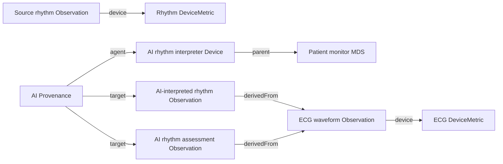

The PoCD Implementation Guide can be used in conjunction with the [AI Transparency IG](http://hl7.org/fhir/uv/aitransparency). This example shows an AI function within a point-of-care device system and distinguishes its rhythm inference from the monitor's existing deterministic rhythm status.

### AI device and workflow

The [AI rhythm interpretation device](Device-AIRhythmInterpretationDevice.html) conforms to the AI Transparency IG's [AI Device profile](https://hl7.org/fhir/uv/aitransparency/2026Jan/StructureDefinition-AI-Device.html). Its `Device.parent` references the patient monitor MDS, representing the AI function as part of that device system. The AI Device identifies the interpreting component; it does not replace the DeviceMetric that identifies the source of a measurement.

The source ECG waveform and rhythm observations each reference their corresponding DeviceMetric. The monitor reports sinus rhythm, while the AI model analyzes a synthetic 10-second, three-lead ECG waveform and produces a coded possible-atrial-fibrillation finding. The AI-interpreted Observation links to both source Observations using `Observation.derivedFrom`; it adds an inference from the longer waveform rather than merely mapping the monitor's rhythm code. The example is illustrative, not a clinical recording or validated diagnostic model.

### Observation examples

The examples illustrate two ways to represent AI output:

- [AI-interpreted rhythm Observation](Observation-AIInterpretedRhythmObservation.html) carries the `AIAST` security label and a SNOMED CT-coded possible atrial fibrillation finding. It derives from both the [source rhythm Observation](Observation-RhythmStatusEnumerationObservation.html) and the [10-second ECG waveform Observation](Observation-ECGSampleArrayObservation.html), rather than copying the monitor's sinus-rhythm code. Its confidence component is an illustrative 0.87 uncalibrated model score, not a clinical probability.
- [AI rhythm assessment Observation](Observation-AIRhythmAssessment.html) provides a separate coded assessment with a brief description of the irregularly spaced ventricular complexes and the same illustrative confidence score. It also links to the waveform through `derivedFrom`.

The coded rhythm finding represents an inference from the waveform, not a direct code-to-code conversion of the monitor's reported rhythm. The monitor's source Observation remains unchanged, and the example does not imply that sinus rhythm alone establishes a normal ECG.

### AI attribution and provenance

The AI Transparency IG defines the [AI Provenance profile](https://hl7.org/fhir/uv/aitransparency/2026Jan/StructureDefinition-AI-Provenance.html). The [Provenance example](Provenance-AIRhythmInterpretation.html) conforms to that profile and records the versioned example AI model as the author agent, the activity as AI-assisted ECG rhythm interpretation, and both AI-influenced Observations as targets. Source Observations are linked from the AI outputs by `derivedFrom`; the Provenance targets identify the resulting AI-influenced resources.

Both AI-influenced Observations use the `AIAST` security label, the artificial-intelligence-asserted code from the [HL7 v3 ObservationValue code system](http://terminology.hl7.org/CodeSystem/v3-ObservationValue). Use the AI Transparency IG's AI Provenance profile to associate the AI agent and activity with the outputs. The example identifies the model and version but does not include a model card or prompt; these may be provided as additional transparency context where appropriate.